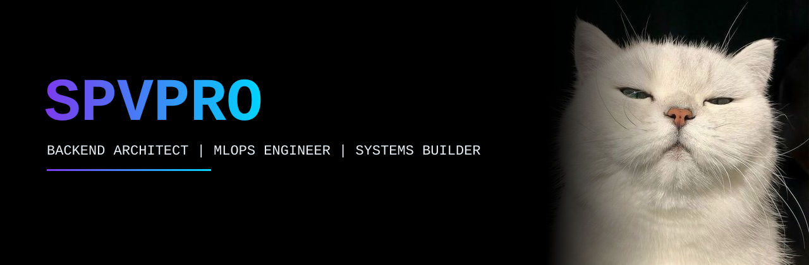

<div align="center">

<!-- ======================== HERO BANNER ======================== -->


<!-- ======================== TYPING TERMINAL ======================== -->
<a href="https://github.com/SPVPRO">
  
</a>

<br/>

<!-- ======================== STATUS PILLS ======================== -->
<p align="center">
  
  <a href="https://github.com/SPVPRO?tab=followers">
    
  </a>
  
  <a href="mailto:spv23095@gmail.com">
    
  </a>
</p>

</div>

<br/>

<!-- ======================== BENTO BOX: IDENTITY & SPECS ======================== -->
<table width="100%">
  <tr>
    <td width="55%" valign="top">
      <h3>🖥️ <code>cat /etc/spvpro/identity.toml</code></h3>
      
```toml
[engineer]
handle     = "SPVPRO"
primary    = "Backend Systems & API Architecture"
secondary  = "MLOps & ML Pipeline Automation"

[stack.highlights]
backend    = ["FastAPI", "Flask", "Express.js", "Node.js", ".NET"]
frontend   = ["Next.js", "React", "Streamlit", "Tailwind"]
databases  = ["PostgreSQL", "MySQL", "MongoDB"]
low_level  = ["C", "C++", "C#", "Java", "Arduino IDE"]

[directive]
motto      = "Secure code is quality code. 🔐"
```
      
  </td>
    <td width="45%" valign="top">
      <h3>⚡ Operational Domains</h3>
      <ul>
        <li><b>⚙️ High-Velocity Backends</b><br/><sub>Designing async microservices, RESTful APIs, and scalable server logic using <b>FastAPI, Express.js, Node.js, and .NET</b>.</sub></li>
        <br/>
        <li><b>🤖 MLOps & Model Deployment</b><br/><sub>Building ML pipelines, serving models through APIs, tracking experiments, and automating training and release workflows.</sub></li>
        <br/>
        <li><b>🌐 Modern Web & Data Apps</b><br/><sub>Shipping reactive interfaces with <b>Next.js & React</b> and interactive data dashboards with <b>Streamlit</b>.</sub></li>
        <br/>
        <li><b>🔌 Hardware & Embedded Systems</b><br/><sub>Writing bare-metal and microcontroller logic in <b>C/C++ via Arduino IDE</b>.</sub></li>
      </ul>
    </td>
  </tr>
</table>

<br/>

<!-- ======================== TECH ARSENAL ======================== -->
<div align="center">
  <h2>🚀 TECH ARSENAL & ECOSYSTEM</h2>
  <p><i>Full-spectrum toolset from low-level hardware C/C++ to cloud-ready web architectures</i></p>
  
  <!-- Modern Sleek Icon Dock -->
  
</div>

<br/>

<!-- 4-Card Tech Matrix -->
<table width="100%">
  <tr>
    <td width="50%" valign="top" align="center">
      <h4>⚙️ BACKEND & CORE LANGUAGES</h4>
      <p align="center">
        
        
        
        
        
        
        
        
      </p>
    </td>
    <td width="50%" valign="top" align="center">
      <h4>🎨 FRONTEND & INTERACTIVE UI</h4>
      <p align="center">
        
        
        
        
        
        
        
        
      </p>
    </td>
  </tr>
  <tr>
    <td width="50%" valign="top" align="center">
      <h4>🗄️ DATA STORES & ENGINES</h4>
      <p align="center">
        
        
        
      </p>
    </td>
    <td width="50%" valign="top" align="center">
      <h4>🔌 EMBEDDED, LOW-LEVEL & OPS</h4>
      <p align="center">
        
        
        
        
        
      </p>
    </td>
  </tr>
</table>

<br/>

<!-- ======================== EXECUTION PIPELINE (ROADMAP) ======================== -->
<div align="center">
  <h2>🗺️ EXECUTION PIPELINE & ROADMAP</h2>
</div>

<table width="100%">
  <tr>
    <td width="33%" valign="top">
      <h4 align="center">✅ DEPLOYED / MASTERED</h4>
      <ul>
        <li>RESTful API Design with <b>Node.js & Express.js</b></li>
        <li>Relational & NoSQL Schemas (<b>PostgreSQL, MySQL, MongoDB</b>)</li>
        <li>Microcontroller Programming in <b>C/C++ (Arduino IDE)</b></li>
        <li>Core OOP & System Logic in <b>Java, C#, and .NET</b></li>
      </ul>
    </td>
    <td width="33%" valign="top">
      <h4 align="center">🔄 ACTIVE SPRINT</h4>
      <ul>
        <li>High-Performance Async Python (<b>FastAPI & Flask</b>)</li>
        <li>Interactive Data Tooling with <b>Streamlit</b></li>
        <li>Full-Stack SSR Web Apps with <b>Next.js & React</b></li>
        <li><b>MLOps</b>, Model Serving & Experiment Tracking</li>
      </ul>
    </td>
    <td width="33%" valign="top">
      <h4 align="center">🎯 NEXT TARGETS</h4>
      <ul>
        <li>Production <b>ML Pipelines</b> (MLflow, DVC, Kubeflow)</li>
        <li>Automated Training & Retraining Workflows in Python</li>
        <li>Dockerized Microservices & CI/CD Pipelines</li>
        <li>Cloud Architecture & Model Monitoring</li>
      </ul>
    </td>
  </tr>
</table>

<br/>

<!-- ======================== FOOTER & CONNECT ======================== -->
<div align="center">
  <h2>📫 INITIALIZE CONNECTION</h2>
  <p><i>Open for Backend Engineering, MLOps Projects, Open-Source Collaboration & Hackathon Teams</i></p>

  <a href="https://github.com/SPVPRO">
    
  </a>
  &nbsp;&nbsp;
  <a href="mailto:spv23095@gmail.com">
    
  </a>

  <br/><br/>

  <code>"Secure code is quality code. Building the future, one secure backend at a time." 🔐</code>
</div>

<!-- Animated Footer Wave -->

